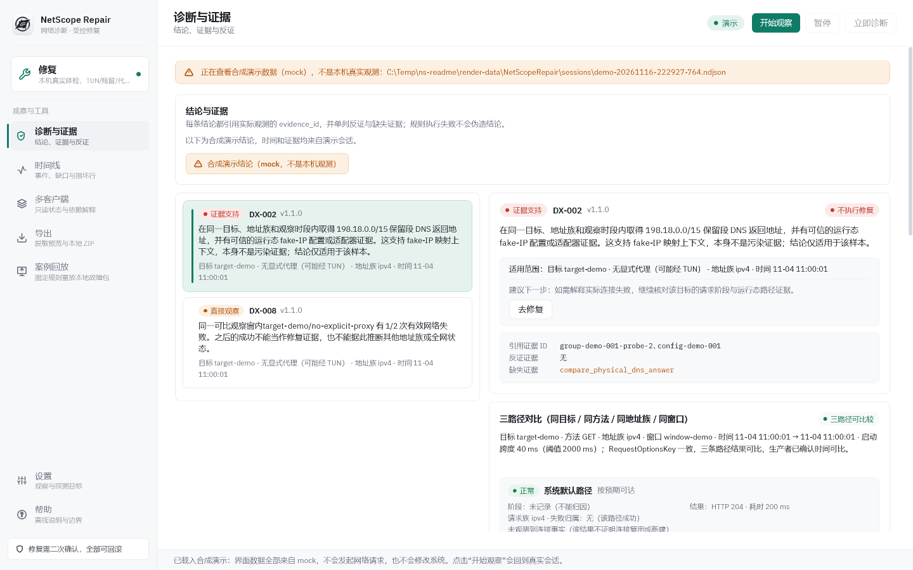
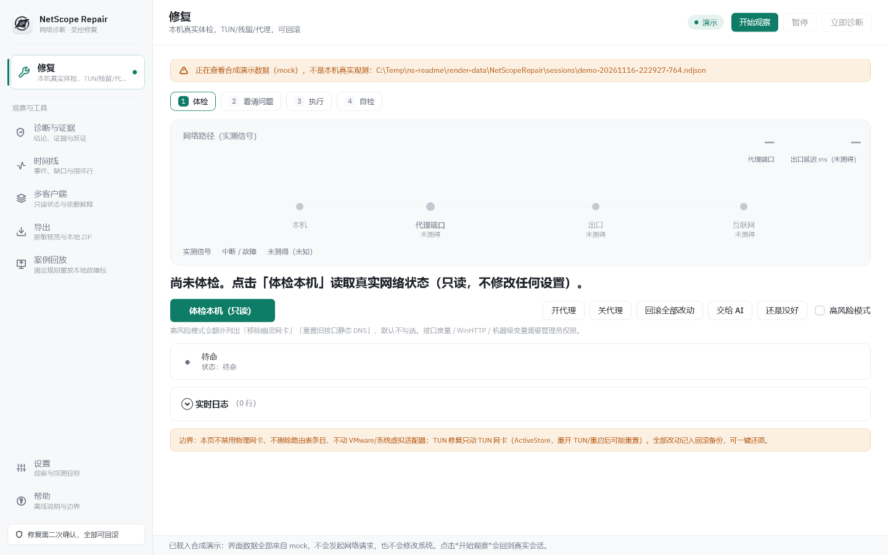
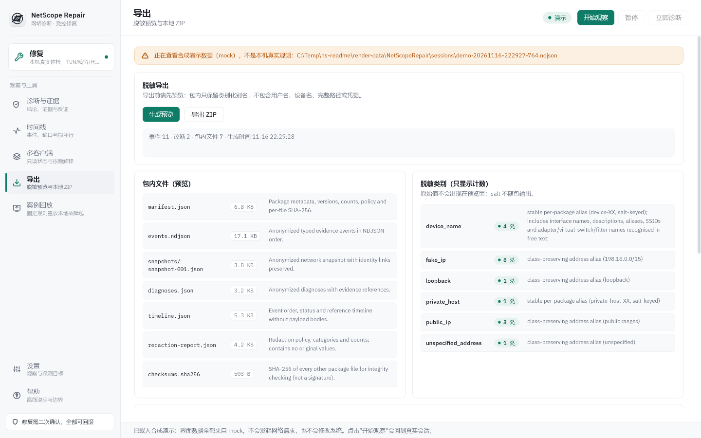
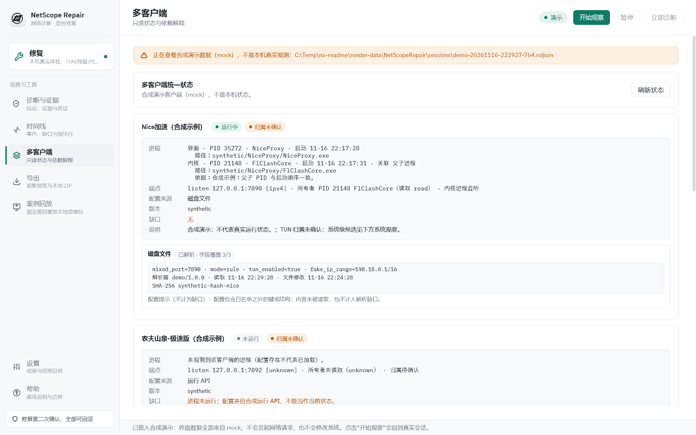
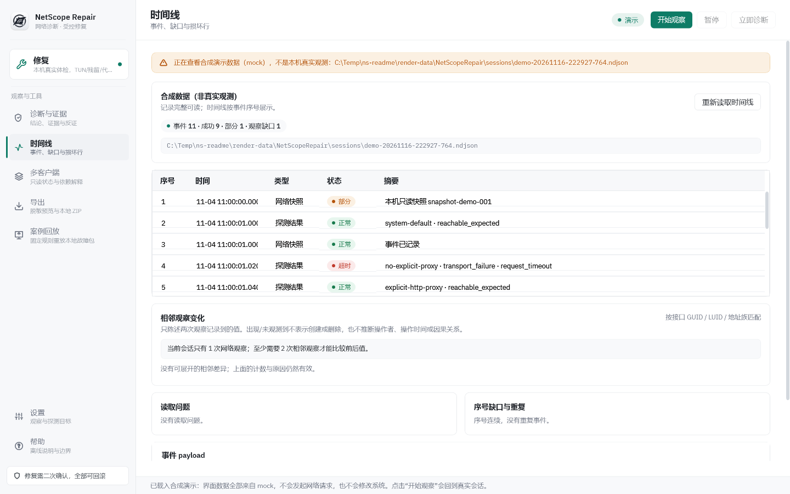
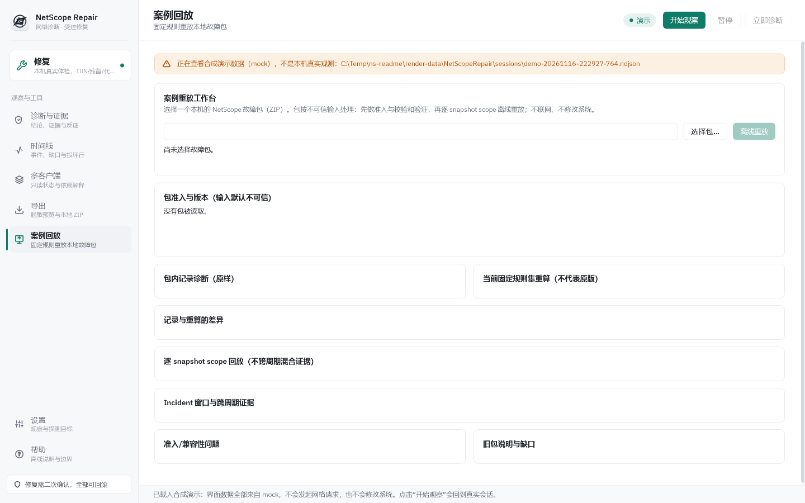
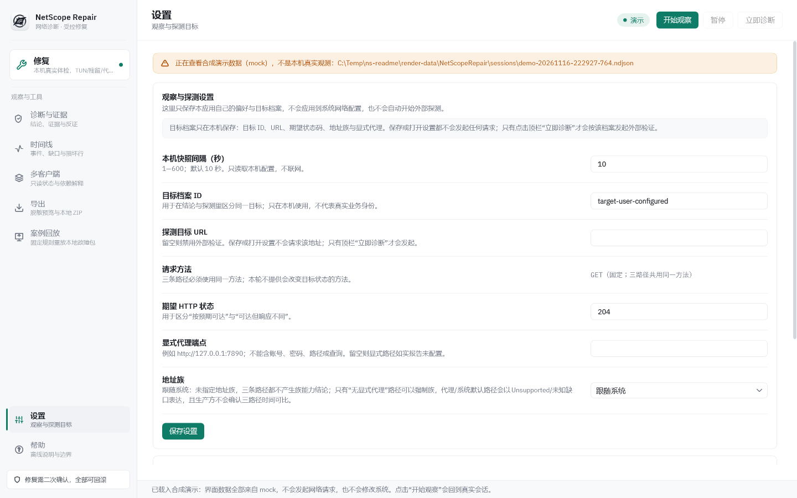
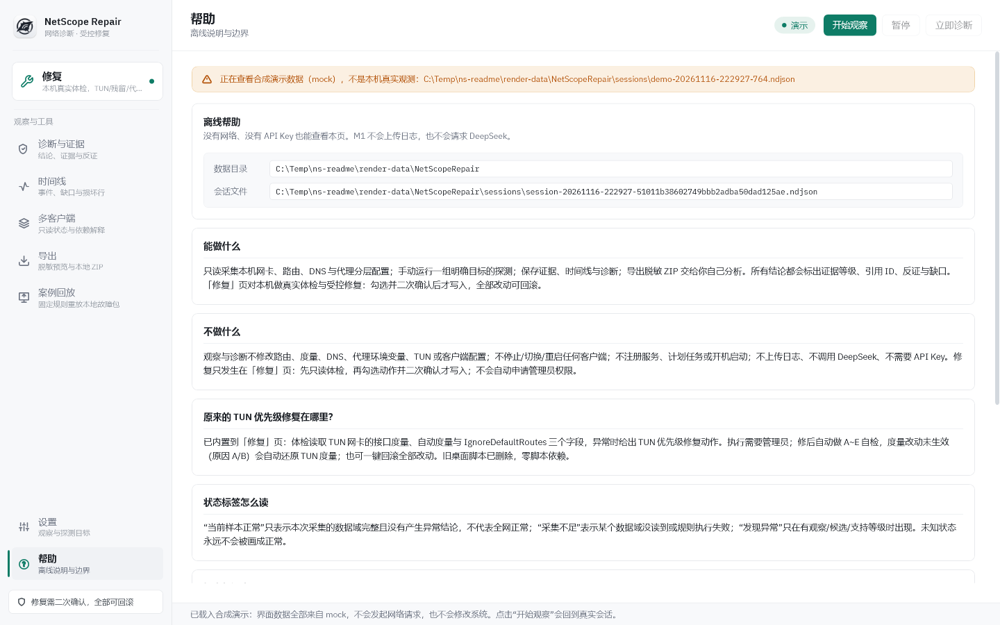

<p align="center">
  
</p>

<h1 align="center">NetScope Repair</h1>

<p align="center">
  Windows 代理网络的<b>诊断与受控修复</b>工具。<br/>
  它是 Nice加速 / Apex / mihomo / Clash 等客户端的<b>伴随助手</b>——不承载流量、不内置代理内核、不替代你的客户端。
</p>

<p align="center">
  <a href="LICENSE"></a>
  
  
  <a href="https://github.com/3247017691/NetScopeRepair/releases"></a>
  
</p>

<p align="center">
  <a href="#-它解决什么">它解决什么</a> ·
  <a href="#-核心能力">核心能力</a> ·
  <a href="#-快速开始">快速开始</a> ·
  <a href="#-安全边界">安全边界</a> ·
  <a href="#-截图画廊">截图</a> ·
  <a href="AGENTS.md">开发者 / AI 指南</a>
</p>

---

## 🤔 它解决什么

用代理客户端时，你大概遇到过这些「网络玄学」：

| 症状 | 背后原因 |
|---|---|
| 🔌 浏览器能上网，一堆软件却断网 | 客户端换了端口，系统代理 / 环境变量还指着**旧端口** |
| 🧟 没开代理，国内软件反而连不上 | 关了客户端，**死代理配置**还残留着 |
| 🧭 开了 TUN，流量却没走 TUN | TUN 网卡的**度量 / 自动度量 / IgnoreDefaultRoutes** 三字段没设对 |
| 🚪 明明没网，系统还往旧网卡送流量 | 旧物理网卡**占着默认路由**不放 |
| ❓ 多个客户端打架、端口被占 | 不知道**哪个进程**占了代理端口 |

NetScope Repair 把这些变成 **可读的诊断结论 → 可勾选的修复动作 → 可一键回滚的改动**，修不好还能**一键打包交给 AI** 继续闭环。

<p align="center">
  
</p>
<p align="center"><sub>诊断与证据：每条结论都引用实测 <code>evidence_id</code>，并列出反证与缺失证据，不伪造结论。</sub></p>

> 📌 本文所有界面截图均为**合成演示数据（mock）**，不代表任何真实本机状态，也不会发起网络请求。

## ✨ 核心能力

### 🩺 本机真实体检

网卡 / 默认路由 / 连通性 / DNS / 代理分层配置 / 端口存活 / 幽灵网卡 / TUN 三字段 / 端口归属——一次读全。**读不到就说读不到**，每个数据域都有状态和原因，不会把「空结果」假装成「正常」。

### 🔧 统一修复引擎

<p align="center">
  
</p>

修复页按 体检 → 看清问题 → 执行 → 自检 四阶段引导，问题与修复动作配对展示，主按钮随阶段变化。

只执行你**勾选并二次确认**的动作，每次改动都记入 journal：

- **死代理清理**：清掉 / 对齐指向死端口的环境变量、系统代理、WinHTTP
- **端口对齐**：把系统代理对齐到**实测可用**的监听端口，不猜端口
- **旧出口自愈**：调高「无 Internet 却仍持有默认路由」的旧接口度量
- **TUN 三字段修复**：接口度量 → 1、自动度量 → Disabled、IgnoreDefaultRoutes → Disabled（只动 TUN 网卡，需管理员）
- **代理开关**：`proxy on|off`，off 即纯直连
- **深度清理**（高风险模式，默认不选）：移除幽灵网卡、重置旧接口静态 DNS

### 🎨 克制界面 + 实时流式反馈

白底「信号仪」控制台：IBM Plex Sans/Mono 字体、单一信号青绿（#0E7C66）、极细分割线，靠亮度阶梯分层而非阴影堆砌。打开即修复页，网络路径仪器实时画出 本机 → 代理 → 出口 → 互联网 的实测信号；**点击即有反馈**，不再「点了没动静」：

- **结构化步骤清单**：每个动作 待执行 → 执行中 → 成功 / 失败 / 跳过，附 before→after 与耗时
- **可展开实时日志**：等宽字体、时间戳、按类型着色、自动滚动到底
- **顶部进度条 + spinner**：已知步数走确定态进度条，未知阶段走 spinner，并遵循系统「显示动画」开关

进度是引擎层细粒度上报的独立侧通道，**不写入** NDJSON / SQLite 事件日志，不改变既有事件契约。

### 🧭 修后自检 + 一键回滚

修复后**实测**默认路由 / 物理出口 / DNS / 直连 / 经代理（A~E 原因分类，最多 3 轮），不是「声明成功」。只有「路由仍未走 TUN」会自动还原，其余原因如实报告。所有改动可 `repair --restore` 或页面「回滚全部改动」**一键还原到首次执行前**。

### 🤖 修复没好？一键交给 AI

<p align="center">
  
</p>

点「还是没好」→「交给 AI」，生成**脱敏失败案例包**（case + context + developer guide）并复制提示词。粘贴给 Qoder 等 AI 助手，即可按指南闭环新增 / 修正修复能力。导出先预览、默认最小化，用稳定别名替换用户 / 设备 / 路径 / 内网地址，**salt 不随包输出**。

### 🖥️ 多客户端端口归属

<p align="center">
  
</p>

候选代理端口被非代理进程占用、或多个客户端同时监听时，**点名进程与 PID**——只报告，不结束进程。只读解析各客户端配置，白名单之外的键绝不读取。

## 🚀 快速开始

### 方式一：下载发布版（推荐）

1. 安装 [.NET 10 Desktop Runtime](https://dotnet.microsoft.com/download/dotnet/10.0)（x64）。
2. 到 [Releases](https://github.com/3247017691/NetScopeRepair/releases/latest) 下载 `NetScopeRepair-v1.1.0-win-x64.zip` 并解压到任意目录。
3. 双击 `NetScope.Desktop.exe`。需要管理员的动作（接口度量 / TUN 三字段 / WinHTTP）请**以管理员身份启动**。

默认自动开始**本机只读快照**，不发起外部探测；关闭窗口隐藏到托盘继续观察，显式「退出」才停止采集。

### 方式二：从源码运行

```bash
dotnet run --project src/NetScope.Desktop      # 桌面
dotnet test NetScopeRepair.slnx                # 8 个测试工程，992 项测试
```

### CLI

发布版 CLI 在压缩包 `cli/netscope.exe`：

```text
netscope status                # 本机体检：死代理 / 残留接口 / TUN / 端口归属（只读）
netscope repair                # 预览修复计划（等同 --dry-run）
netscope repair --apply --yes  # 真执行默认动作；加 --deep 含高风险项
netscope repair --restore      # 回滚到第一次执行前的状态（含 TUN 三字段）
netscope proxy on|off          # 开 / 关代理；off = 纯直连
netscope handoff               # 生成 AI 失败案例交接包并打印提示词
```

只有 `--apply` 与 `proxy on|off` 会写系统；其余命令都是只读预览。

## 🔒 安全边界

- **诊断默认只读**，不需要管理员；写入只在「勾选动作 + 二次确认」之后发生。
- **不自动申请 UAC**：权限不足的动作如实跳过并报告，不假装成功。
- **TUN 修复只动 TUN 网卡**：不禁用物理网卡、不删路由表条目、不动 VMware / 系统虚拟适配器。
- **零脚本依赖**：不注册服务 / 计划任务 / 开机启动项，不重启客户端或内核。
- **端口冲突只点名不杀进程**；多 TUN 只报告建议，不替你关客户端。
- **不上传日志**：AI 交接包只生成本地文件且先脱敏，是否交给 AI 由你决定。
- **全部改动可回滚**：每次写入记入 journal，`repair --restore` 回到首次执行前。

## 🖼️ 截图画廊

<table>
  <tr>
    <td width="50%"><br/><sub>时间线 · 事件、缺口与损坏行</sub></td>
    <td width="50%"><br/><sub>案例回放 · 固定规则重放本地故障包</sub></td>
  </tr>
  <tr>
    <td width="50%"><br/><sub>设置 · 观察与探测目标</sub></td>
    <td width="50%"><br/><sub>帮助 · 离线说明与边界</sub></td>
  </tr>
</table>

## 📚 文档

- **[AGENTS.md](AGENTS.md)** —— 面向开发者与 AI 助手的完整技术指南：能力清单、目录结构、设计要点、CLI 全命令与历史报告索引。
- **[docs/adr/](docs/adr/)** —— 架构决策记录。
- **[docs/reports/](docs/reports/)** —— 各任务与门禁报告（含历史复核存档）。

## 📄 许可证

[Apache License 2.0](LICENSE) © 2026 GMorning0602 —— 可自由使用、修改、分发与商用，保留版权与许可声明即可，并含明确的专利授权。
